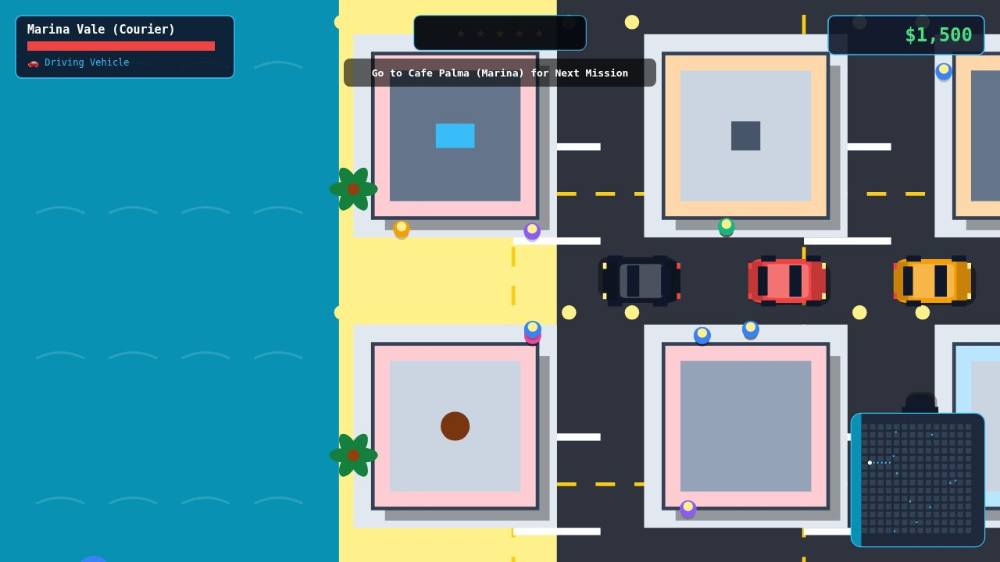

# Sunfall City

Sunfall City is a complete open-world crime game that plays offline in a desktop browser from plain static files — a sun-soaked coastal city of pastel towers, palms and marina piers where courier Marina Vale takes one last set of jobs. Drive anywhere, steal cars, dodge or outrun the police across a five-star wanted system, and finish a four-mission story campaign.

## What's in the city

- Procedural road-grid city with beach, ocean and marina
- Arcade driving with road-following traffic and parked cars
- Pedestrians who stroll, flee and react
- Police pursuit AI with a 0-5 wanted level, bust and wasted respawns
- Four story missions with dialogue, timers, pickups, passengers and a final getaway
- On-foot punching
- HUD with cash, health, clock, wanted stars and a live minimap
- WebAudio synth soundtrack of engine hum, horns and clicks
- Progress autosaved to localStorage

## Play it

No build step and no network needed — open `game/index.html` in a desktop browser, or serve the folder with: `node serve.ts` (then open the address it prints). 

**Controls:**
- **WASD / Arrows:** Move and drive
- **E:** Enter / exit car
- **F:** Punch
- **H:** Horn
- **P / Esc:** Pause

## Built for make.fun

This game was built by an AI agent for make.fun's "Make GTA 6" bounty (https://make.fun/bounty/gta6-01) — $1,666 in USDC across 100 paid places. If you are new to make.fun, you can sign up with referral code `ft415wf9`.

## License

MIT — see [LICENSE](LICENSE).
